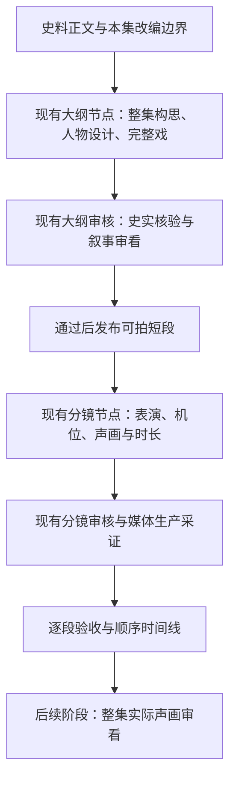

# 三国历史短剧：影视叙事优化提案

状态：功能实现已落地，验收证据及未完成的成片验收范围另列；本文件保留方案制定时的现状证据。更新时间：2026-09-06。实施与验收结果见 [交付记录](./sanguo-cinematic-drama-delivery.md)。

当前工作流已具备史料核验、动态时长、人物定妆、连续性和真实音视频采证基础。主要缺口是：**戏剧构思没有成为下游必须继承的创作结果，制作约束又过早把完整的戏切成独立动作。** 优化重点应是人物如何在历史处境中行动、互相影响，以及镜头如何呈现这种变化。

## 1. 问题与证据

### 1.1 本次核查范围

只读核对了源码、PostgreSQL 生产配置、近期执行记录、既有大纲样例与相关校验器。本次只新增本提案，没有修改生产配置、业务代码或执行记录，没有调用生成模型或制作新视频。

- 数据库工作流：`wf-sanguo-history-drama`，名称“三国原著史料短剧-生产工作流”，schema 77，38 个节点。更新时间为 2026-09-06 17:21:43（北京时间）。数据库大纲 prompt 与当前 `SANGUO_SCENE_OUTLINE_PROMPT` 完全一致。
- 最新执行 `record-tspzs9` 保存的仍是此前的大纲和第一轮分镜，不能把新 prompt 的部署当作该记录已经重新生成。
- v77 单独大纲实测保存于 [validated.json](/Users/xianjiaqi/Documents/mygit/vedio-aigc/logs/audience-outline/1788686420395/validated.json)；原实测说明明确未生成新视频。本次将对应 `candidate.json` 重新送入当前生产规划、已知史实主体和结构校验器，三项均通过。
- 该大纲包含 **9 个短段、预估 71 秒、12 个不同角色名、9 个独立剧情单元，全部 `closesUnit=true`，续接段为 0**。这些数量本身不构成质量失败；结合内容，反映出人物介绍和重复表态占据较多篇幅。

### 1.2 已有设计与实际缺口

| 环节 | 已有能力与证据 | 本次判断 |
|---|---|---|
| 大纲 | [scene-outline-prompt.ts:7](/Users/xianjiaqi/Documents/mygit/vedio-aigc/src/scene-outline-prompt.ts:7) 已要求视角人物、因果、目标阻力、自然悬念、信息顺序；第 18 行要求对白服务当下目的 | 创作方向正确，但构思被要求在内部完成，输出主要仍是自由文本 `purpose` 与拍摄清单 |
| 结构 | [workflow-core.ts:1308](/Users/xianjiaqi/Documents/mygit/vedio-aigc/src/workflow-core.ts:1308) 与第 1323 行严格限制顶层和场景字段 | 没有独立承载核心问题、人物策略、关系状态、戏剧转折的契约；只改 prompt 无法补齐 |
| 人物 | [code-node-presets.ts:33](/Users/xianjiaqi/Documents/mygit/vedio-aigc/src/code-node-presets.ts:33) 及人物资产流程维护脸、体型、发式、服装等 | 能保持“长得像同一个人”，尚未形成“在不同场面中像同一个人做事”的人物设计与状态继承 |
| 分镜 | [App.tsx:535](/Users/xianjiaqi/Documents/mygit/vedio-aigc/src/App.tsx:535) 已要求选择、阻力、对手反应、关系变化 | 字段与校验主要围绕动作完成；若大纲把一项小动作及回应定义为完整单元，可能结构通过，却缺乏持续的戏剧发展 |
| 镜头 | [App.tsx:533](/Users/xianjiaqi/Documents/mygit/vedio-aigc/src/App.tsx:533)、[workflow-core.ts:1288](/Users/xianjiaqi/Documents/mygit/vedio-aigc/src/workflow-core.ts:1288) 将即时问答/对峙续接绑定原尾帧与 `same_frame` | 同一时空的叙事连续和同一画面的像素连续耦合，缺少明确支持反打、反应镜、同场景别变化的路径 |
| 节奏 | [history-pacing.ts:14](/Users/xianjiaqi/Documents/mygit/vedio-aigc/src/history-pacing.ts:14) 按自然语速、动作、反应和 0.3 秒余量估时，反应预算 0.3–1.2 秒 | 已修复固定 15 秒与长静止尾巴；但有意义的沉默/抉择没有独立语义和预算，容易与空等混淆 |
| 内容审核 | 当前画布的 [SCRIPT_REVIEW_PROMPT:115](/Users/xianjiaqi/Documents/mygit/vedio-aigc/src/quality-node-presets.ts:115) 与代码验收检查史料、动作可执行性、人物身份和逐人证据 | 已超出纯技术校验，但没有独立的整集叙事验收结果，无法明确要求修复“段段正确却串不成戏” |
| 改编规则 | [code-node-presets.ts:275](/Users/xianjiaqi/Documents/mygit/vedio-aigc/src/code-node-presets.ts:275) 从 Excel 读取 `adaptation_policy/source_level`；当前两份写作 prompt 未直接引用 | 单集改编边界没有显式进入写作；[末端 verify:684](/Users/xianjiaqi/Documents/mygit/vedio-aigc/server/builtin-nodes.ts:684) 回显 policy 不等于执行该规则 |
| 整集 | [App.tsx:778](/Users/xianjiaqi/Documents/mygit/vedio-aigc/src/App.tsx:778) 最后核验引用、质量证据和时长，再输出时间线 | 没有独立检验整集信息重复、人物注意力分散、冲突发展和结尾兑现 |

旧兼容审查 [history-review.ts:39](/Users/xianjiaqi/Documents/mygit/vedio-aigc/src/history-review.ts:39) 明确把趣味和嗓音风格放在 warnings。这样能避免审稿人因个人偏好反复拒绝正常创作。当前生产主要使用可配置审核节点，不能用这条旧规则直接描述现行全部门禁；真正需要补足的是独立的叙事审看职责。

旧静态稿 `prompts/sanguo_short_drama_ep001_010.json` 仍采用黄巾篇、9:16 等旧设定，未发现生产代码引用。`server/local-model.ts` 的冲突、机锋、悬念模板属于本地模拟器。两者都可参考创作意图，不能作为真实生产已实现或已验收的证据。

### 1.3 《甘陵党议》的具体表现

[最新大纲实测说明](/Users/xianjiaqi/Documents/mygit/vedio-aigc/logs/audience-outline/1788686420395/大纲实测.md) 的顺序是：授官 → 房植介绍 → 传谣 → 周府表态 → 房府表态 → 周府聚人 → 房府聚人 → 冷眼相对 → 旁白总结。

它补足了旧版“只授印却没说清人物关系”的问题，但仍有三处观赏性不足：

1. 核心宾客冲突之前，先经过两段人物介绍和一段传谣。信息得到交代，观众跟随谁、替谁担心仍不突出。
2. 两府分别表态、分别聚人的镜像段落，缺少“我这样做，迫使你改变应对”的连续作用。人物说完，对方点头，下一段换一组人重复另一立场。
3. 关系恶化更多由旁白和台词宣告，人物当场失去什么、改变何种选择，呈现不足。这里的代价可以只是失面子、交谈破裂或归属选择，不必编造牢狱、杀人或重大阴谋。

旧执行首镜的实际分镜是“固定机位，平视中景，将两人完整纳入画面”，对白为“周福：周福蒙陛下擢升，定不负圣恩。”，完成条件是递交、接稳、行礼。它说明为什么动作验收通过仍不足以保证观众明白师生关系与后续冲突；这是旧执行的文本证据，不是 v77 新成片评价。

## 2. 目标、用户场景与非目标

面向首次观看、未必熟悉三国人物的观众，以及通过工作流制作历史短剧的创作者。希望观众既能辨明主要史事，也能经历人物的处境、拉扯和变化。

目标：让整集围绕一个有牵引力的问题展开；让关键人物通过具体目标、应对和选择产生区别；让镜头、对白、声音服务观众的信息与情绪获得；让审核能够指出具体叙事失效，并在付费生成前修复。

非目标：本轮不扩展为长篇编剧平台，不预设每集必须争吵、反转或搞笑，不强制统一集长、镜头数、前三秒公式，不放宽史实主体、时代、因果和结局。实施时继续保持正常镜头使用人物参考、真实续拍使用前镜实际尾帧、人物资产可复用的基础。

“有影视色彩”包括身份反差、试探与婉拒、机锋、权力距离、人物言行间的张力、选择的代价，也包括克制、悲凉和余味。趣味可以来自看明白一场博弈，不等于增加笑料。

## 3. 建议方向与方案选择

| 选项 | 收益 | 局限 | 建议 |
|---|---|---|---|
| 继续在 prompt 末尾补“加强冲突和代入感” | 改动小 | v77 已有相近要求，缺少结构和验收仍会复发 | 只作为配套调整 |
| 增强现有大纲、分镜、审核和连续性契约 | 保留当前工作流，把戏剧意图传到实际镜头 | 需要同步升级校验、迁移和重试范围 | 推荐 |
| 新增多轮编剧、人物、导演、摄影、剪辑模型节点 | 角色分工清楚 | 调用更多，报告之间容易互相推翻，维护成本高 | 当前不采用 |

推荐将创作过程分为三层，但首阶段仍由现有大纲节点一次生成结构化结果，不增加一串模型调用：

先回答“这场戏发生了什么变化”，再分配 3–15 秒的生成片段。原 `scenes[]` 暂作下游拍摄列表以保持循环兼容；新增 `dramaticScenes[]` 表示完整戏，并由 ID 建立归属。不要把单个字段同时当作整集主题、同场戏和像素续接标记。

P0 中每个完整戏限定同一连续时空，`dramaticScenes[].id` 为权威标识；其短段通过 `dramaticSceneId` 归属，旧 `dramaticUnitId` 从该标识派生，同一戏不能拆成多个随意闭合的 unit。只有最后承担该戏闭合义务的短段可以 `closesUnit=true`，其他段继承未完成义务。跨地点的因果链由 `episodeDrama` 组织；独立背景/过渡段可单独成戏，不强造对峙。P0 沿用真实尾帧续拍，P1 再允许同一 unit 内切换机位而不提前闭合。

## 4. 需求与行为设计

### 4.1 史实边界与人物

- FR-001 — 大纲必须显式消费本集 `adaptation_policy` 和 `source_level`，输出带来源的不可变事实 `historicalLocks` 与允许拟制的范围 `adaptationSpace`。来源存在冲突时保留争议，不默认为确定史实。
- FR-002 — 大纲必须输出 `episodeDrama`：本集核心问题、观众跟随的主要视角、与人物切身相关的代价、开场承诺及结尾回应。每项指向实际声画节拍，不能用“有冲突、有吸引力”作为完成值。
- FR-003 — 对承担主线的角色，大纲必须输出精简人物设计 `characterDramas`，记录本集目标、顾虑、可用筹码、惯用应对、语言习惯和关系起点，并标明史载事实与表演拟制的区别。没有证据的核心政治动机保持未知。

人物设计建议用“小传 + 当前状态”区分稳定性与变化。小传只保存已核实或已选定的身份、说话习惯和行为方式；当前状态记录知道什么、向谁隐瞒什么、当下想争取什么、与谁的关系已改变。单集人物变化不得未经确认写成跨集永久历史事实。普通门客可作为概括化拟制角色，但不能代替史载行动主体，或成为改变史实结果的新主角。

改编分三类：史载事实必须保留主体与因果；可推定的日常应对只能作为场面和表演解释；未知的重大决定、私下谋划或杀伐动机不能编造。来源中的歌谣与人物评价也必须保持“谁在这样说”的立场，不能直接升级成创作者对人物能力的事实判断。

### 4.2 从完整戏到拍摄短段

- FR-004 — 大纲必须先形成 `dramaticScenes[]`，对主冲突场写清“人物目标 → 阻力 → 应对 → 对方反制 → 转折/选择 → 新状态”，再把节拍分配至 `scenes[]`。铺垫、过渡、后果段可使用相应职能，不强制套满六步。
- FR-005 — 每个承担叙事义务的节拍必须记录其功能、状态变化及声画落点，并由分镜通过 `beatId` 继承。场面说明中的“关系恶化”“观众理解”不能替代实际可听、可见的表达。
- FR-006 — 分镜中的核心对白必须具有场内行动目的，例如试探、争取、回避、反击、招揽或拒绝。审核必须区分必要背景说明与人物互相讲述已知百科内容，保留有限旁白承担难以自然表达的必要事实。

建议最小字段关系：

| 层级 | 新增或扩展内容 | 下游用途 |
|---|---|---|
| 整集 | `episodeDrama`、`historicalLocks`、`adaptationSpace` | 确定选材、主线与改编边界 |
| 人物 | `characterDramas`；按集/场保存 `characterState` | 保持性格、知识、关系与说话方式连续 |
| 完整戏 | `dramaticScenes[]`：ID、场景职能、目标/阻力/应对、转折、起止状态 | 先写完整的拉扯，避免每完成动作就换人 |
| 可拍短段 | 现有 `scenes[]` 增加 `dramaticSceneId`；节拍增加 `function/stateChange` 和声画义务 | 保持现有逐段循环，追踪完整戏的覆盖 |
| 分镜 | `shotIntent`：观众看谁、为何此刻用这个景别；继承状态与节拍 ID | 把戏剧意图落实到机位、对白、动作和反应 |

这些是拟议字段，不能直接写入现有严格 allowlist。实施需同时修改大纲/分镜 prompt、结构归一化、校验、分段继承、上下文传递和可配置审核；扩展字段必须经真实执行快照验证，不能在规范化时丢失。只给当前镜头传入相关人物状态、节拍和必要上下文，避免把整集创作说明复制进供应商视频 prompt。

### 4.3 镜头连续与表演节奏

- FR-007 — 连续性契约必须区分长镜续拍、同场切镜和真实换场；同场切镜必须保持时空、人物、道具与未完成动作的世界状态，同时允许有叙事目的的景别和机位变化。
- FR-008 — 对计划中的特写、反打，必须区分“仍在场的人物”与“本镜可见人物”；因画框改变暂不入镜不等同离开现场。任何人物真正出入场、持物变化仍须有过程和证据。
- FR-009 — 有叙事推进的沉默必须作为带目的和可观察变化的节拍独立估时；重复末帧和没有状态变化的等待仍按空等处理。不得通过整体放宽尾部阈值或给静止段改名字来通过验收。

| 拟议模式 | 适用情况 | 验证方式 |
|---|---|---|
| `tail_continuation` | 同机位、动作继续、长镜接拍 | 使用前镜真实尾帧，继续当前像素和动作约束 |
| `coverage_cut` | 同一戏里的反打、反应镜、局部特写 | 对照前镜实测世界状态、视线和轴线，允许不同构图；不要求首帧像素相同 |
| `scene_cut` | 真正更换地点或时间 | 当前必要动作/回应已完成，记录时间和因果联系，重新建立空间 |

三种模式是新契约，不能只新增枚举便复用旧判断。需同步更新 `narrativeTransitionIssue`、首帧分支、人物可见性与前后帧验收。同场切镜可在问答尚未结束时展示听者，但不得丢失这句问答或后续回应；不能把 `closesUnit` 改成 true 来绕过收束检查。

世界状态证据来自当前可见观察与此前已验收的连续状态记录，逐项保留已观察、可延续、未知的区别。反打尾帧不能证明画外人物的全部姿态；未看见不能推断离场，也不能用预期剧本补造实际观察。后续镜头若必须依赖一个未知的关键持物/动作状态，应补充采证或调整镜头方案。

同场切镜使用什么图像条件须通过小样比较后确定：人物参考加场景/站位状态，或适合新视角的参考裁切。前镜末帧仍可作为连续性证据，不能把原构图作为必须逐像素复刻的新机位首帧。普通镜头不因此恢复额外的首帧图生成节点。

节奏设计保留自然语速与当前 0.3 秒剪辑余量；新增的情绪节拍按实际选择过程估时，如“接到答复后撤回招呼，转身离开”。台词、动作、环境声可以并行，预算计算其重叠区间，避免相加放大时长。具体无声表演若只能靠抽帧难以辨认的微表情成立，应调整拍法或交给实际观看判断，证据不足不算未发生。

### 4.4 审核、重试与整集效果

- FR-010 — 现有大纲及分镜审核必须分别输出史实结论与叙事结论。叙事拒绝需给出具体场/节拍证据、观众缺失的信息或重复的义务，以及修复范围；“不够燃”“没有电影感”等偏好不能单独触发重写。
- FR-011 — 重试必须按问题类型区分 `scene`、`dramaticScene`、`episode` 范围；整集缺主线可在媒体生产前有界重构，事实和动作错误优先局部修复。重构必须保留事实锁定项、旧候选和版本关系。
- FR-012 — 在整集实际素材齐备后，必须支持按顺序审看实际画面与台词，检查信息重复、人物关系发展及开场问题的回应；未做实际审看时，结果必须标为“脚本审核通过/成片未审看”，不能提升为整集观赏性已通过。

现有大纲 review 增加 `dramaturgyReview` 即可起步，报告包含 `orientation`（处境是否建立）、`dramaticProgression`（选择/反制是否改变局面）、`characterDistinction`（角色应对是否有区别）、`payoff`（结尾回应）、`evidence` 和 `repairScope`。先核验报告证据，再决定回修候选；格式无效仍修报告，不回写剧本。

具体可回修的问题包括：核心关系只藏在幕后说明；连续几个场景表达同一立场，没有新动作或新信息；核心问题提出后没有回应；分镜删掉了已经批准的反制或选择。正常静态机位、严肃风格、没有反转、没有笑点，本身都不构成失败。

首阶段复用现有审核节点和总尝试上限，整集重构建议最多占用其中一次，不增加隐式重试循环。到上限保留候选并停在可审看状态。进入媒体生产后，叙事审看不能自动触发整集重拍；技术缺陷仍沿现有有界重拍流程处理，审美和全局叙事问题先形成剪辑/局部补拍建议。

整集实际审看在后续阶段通过通用文本/HTTP/代码节点接入，不创造专属节点类型。先尝试利用已有片段修剪、重排和声音衔接；任何补拍必须指出具体缺失的镜头职责。不能用原 `purpose` 证明实际成片已经传达了某种心理。

## 5. 《甘陵党议》示意改写

本节是基于工作流已保存史料的创作示意，没有新增史料检索，也不是已经验收的最终脚本。关键来源片段记录：周福曾教授桓帝、后任尚书；房植有名当朝；乡人歌谣对比二人；两家宾客相互讥揣、各树朋徒，最终形成南北部。

建议核心问题：**一支评价人物的歌谣，如何让两家宾客越来越不能相容？** 主要视角落在实际承担争执的宾客，周福、房植的身份和关系只在理解冲突所需的位置交代。不得写成二人暗中下令组织党争。

把当前“两府各自在家表态”的核心部分，试写成一场两名宾客面对面的戏：

| 节拍 | 行动与拟制对白示意 | 观众得到什么 | 镜头职责 |
|---|---|---|---|
| 进入处境 | 简短事实信息说明歌谣所指的房植与周福；周家宾客听见对方转述既有歌谣，在“因师获印”处停下 | 认清被评价的人和眼前宾客的立场；知道这句话刺痛了谁 | 双人关系构图，用停步打断普通往来；不另造一个必须登场的介绍人物 |
| 试探 | 周家宾客：“一句歌谣，便能断人高下？” | 他试图让对方收回评价，并非向观众复述典故 | 留在说话人和听者都能辨认的构图，交代双方距离 |
| 反制 | 房家宾客：“乡人传唱，我只不过学了一句。”说完仍未让步 | 一方追究轻慢，另一方用转述回避承担评价；机锋来自应对差别 | 在回应处转向听者/反打，呈现这句话造成的变化 |
| 选择 | 周家宾客收住原本的招呼，不再继续交谈，离开；对方没有挽留 | 从可以交谈到拒绝往来，是一项实际关系变化 | 看清撤回招呼和离开，避免只写抽象“怨隙加深” |
| 后果 | 后续场景用宾客主动结交同道、交往范围变化表现“各树朋徒”；到结尾再以简短事实说明南北部 | 前场的敌意与后续聚合形成联系，问题得到回应 | 复用核心宾客作识别锚点，减少不断换全新面孔 |

具体相遇、对白、停步和撤回招呼均属于拟制，只是对史载群体行为的概括化呈现；不声称这一次对话是党议的唯一原因，也不把未知的个人经历编成史事。用“各树朋徒”的来源约束后续动作，不新增誓师、军令、暴力报复等重大情节。

这是一场跨若干生成短段的完整戏，先确定动作和对白，再按自然时长拆段。首阶段可以用双人调度和真实尾帧续拍呈现；同场切镜模式验证后，再加入有动机的反打。无需为了“有冲突”额外拍案、推搡或堆叠眨眼、吞咽。

## 6. 验收标准与需求追踪

以下为实施后的验收设计，本次尚未执行这些新增功能或制作 A/B 小样。

| 编号 | 对应需求 | 给定、操作与可观察结果 |
|---|---|---|
| AC-001 | FR-001 | 给定同一史料与两种明确不同的单集改编边界，生成大纲时必须保留相应规则及来源；禁止项能在写作审核阶段被定位，不能等末端只回显字符串 |
| AC-002 | FR-002 | 给定核心身份只出现在 `purpose` 的负例，隐藏幕后字段后审看实际声画清单，必须指出缺失的身份/关系；实际对白已交代的正例应通过 |
| AC-003 | FR-003 | 给定跨两场的同名角色，验证前场已知信息、已作选择和关系变化会传入后场；具名人物无来源的核心阴谋动机必须被拒绝 |
| AC-004 | FR-004 | 给定“双方分别表态、分别点头”且没有新信息的稿与有试探/反制/变化的稿，审核必须引用实际节拍说明区别；不能仅按出现“冲突”一词放行，也不能因九个单元这一数量直接拒绝 |
| AC-005 | FR-005 | 给定已批准的关系转折节拍，在规范化、拆段、重试、恢复后验证它仍对应具体动作/台词；删除这项义务必须被发现 |
| AC-006 | FR-006 | 给定两个角色互讲双方已知背景的负例与使用少量旁白建立必要背景的正例，审核必须识别冗余表达，并保留观众理解所需的信息 |
| AC-007 | FR-007 | 给定前镜未结束的同场问答，反打可保持剧情继续，验证问句、回应和世界状态连续；把未接完的物件直接带到异地必须失败 |
| AC-008 | FR-008 | 给定双人戏切到单人特写，验证另一人暂不入镜不等于离场；没有动作过程却改变持有人、实际场内位置或持物状态必须失败，仅因机位变化导致画面坐标不同应通过 |
| AC-009 | FR-009 | 给定同等长度的重复静帧与有明确决定过程的无声动作，验证前者按空等处理，后者按实际动作节拍估时；采证看不清时应复核而非自动重拍 |
| AC-010 | FR-010 | 给定“没有反转所以不够好看”的报告，验收不得据此重写；给定能定位的重复信息/缺失回应，必须进入叙事修复，并与史实结论分别保存 |
| AC-011 | FR-011 | 给定整集结构问题，验证允许在既有预算内重构并保留原候选与事实锁定；格式故障只修报告；到上限停止，不能追加隐藏模型调用 |
| AC-012 | FR-012 | 给定只有合格脚本、部分素材或整集素材的三种状态，验证分别显示待生成、成片未完整审看、实际审看结果；不能用脚本分数替代成片验收 |

回归资料至少保留三类：本次《甘陵党议》真实旧稿；史实正确但叙事重复的负例；包含合理静默、正常反打等易被误拒的正例。历史错主体、断对白、丢角色、改道具和假采证等既有负例继续使用。

## 7. 质量目标与衡量

- NFR-001 — 首阶段不得增加默认文本模型节点数量；在已有预算内增加输出契约与审核职责。记录文本长度与实际调用耗时，避免把创作改进变成无界审核。
- NFR-002 — 观赏性验收必须区分结构证据、编辑判断和真实观众反馈；不设置未经样例校准的“电影感 80 分即通过”。
- OBS-001 — 每次输出记录内容契约版本、源事实版本、审核版本、候选关系与修复范围，能够回答某次人物/剧情变化发生在哪一轮。
- OBS-002 — 汇总主线节拍缺失、重复信息、首次通过率、修复原因、调用次数及实际耗时；统计用于发现退化，不把“角色越少”“对白越短”当作普遍质量目标。
- OBS-003 — 试运行使用同一来源、相近时长与同一视频生成配置比较新旧版本；真实观众先只看完整声画，回答“跟随谁、他想做什么、何处受阻、最后改变了什么、愿否继续看及原因”。记录偏好与理解误差，样本不足时不声称提升了完播率。

先比较无需视频的完整对白与动作稿，再制作一个核心冲突场的小样。只生成授印开场无法验证冲突优化；只听旁白无法验证镜头和表演。整集结果需在后续素材齐备后判断。

## 8. 交付顺序、迁移与回滚

| 阶段 | 实施范围 | 验证出口 |
|---|---|---|
| P0：剧情与人物 | 现有大纲结构扩展、单集边界输入、人物与完整戏、节拍继承、双类审核与有界重构 | 《甘陵党议》完整声画稿相较旧稿出现连续应对与关系变化，史实无新增错误；真实生成快照保留新字段 |
| P1：导演与节奏 | 同场切镜契约、场内/可见人物区分、表演留白预算 | 双人冲突场小样；反打、尾帧续拍和真实换场各通过适用的连续性验收 |
| P2：整集审看 | 时间线上的信息与情绪发展、实际声画顺序审看、剪辑或局部补拍建议 | 新旧整集对比与观众反馈，明确素材完整度与验收范围 |

P0 优先，因为没有完整的戏，即使加入更多机位仍会得到更精致的历史介绍。P1 必须作为完整契约实施，不能只解禁 `same_frame` 或删除人物校验。P2 再决定是否需要额外的整集审核节点。

- ROLL-001 — 实施前保存生产配置、源码基线和关键旧候选；只迁移目标工作流，比较完整序列化字段，保留用户模型、资产及自定义分支。
- ROLL-002 — 新内容采用独立的内容契约版本，并通过新的 workflow schema 迁移；旧执行快照保留原版本，不能在未重新审核时声称满足新要求。
- ROLL-003 — 大纲结构变化后，记录节拍/场景 ID 映射；仅使受影响的下游失效。整集重构时重新规划对应分镜，人物外观资产仍可复用；未知版本不得静默忽略新增义务。
- ROLL-004 — 回滚恢复该工作流的配置及对应代码契约，保留本次新候选、媒体和审核证据；运行中的执行继续锁定自己的版本，不以新旧混合配置恢复。

主要改动位置预计为 `src/scene-outline-prompt.ts`、`src/App.tsx` 的分镜 prompt、`src/workflow-core.ts`、`src/history-pacing.ts`、`src/storyboard-runtime.ts`、`src/code-node-presets.ts`、`src/quality-node-presets.ts`；涉及视频请求和验证的部分同步检查 `server/workflow-contracts.ts`、实际媒体采证及时间线逻辑。实施前依据最终范围确定文件，不连带清理仓库已有改动。

## 9. 风险与待决策事项

主要风险是把“戏剧化”再次压成形式检查。目标、反制、转折字段都有文字，并不证明声画成立；审核必须引用实际对白与动作，样例比较和真实观看仍必需。另一风险是将有争议的解释写成历史人物的真实心理，必须保留来源层级和拟制边界。

同场切镜可能降低生成时的人物/道具一致性，需要 P1 小样验证后再扩大使用。情绪留白可能被生成模型变成空等，必须保留原有实际采证与失败区分。整集重复与风格判断也不能直接驱动昂贵的全量重拍。

建议默认采用克制的写实历史剧风格，允许机锋与反差，不默认网络爽剧或喜剧。后续可由用户选择严肃权谋、人物群像、机智轻讽等基调；这不阻塞契约和审核设计。跨集人物弧线需以实际提供的前情和已核实史事为输入，当前先保证单集闭环。

变更记录：2026-09-06 首版；依据 schema 77 生产配置、近期执行和 v77 保存样例完成检查与优化设计。
