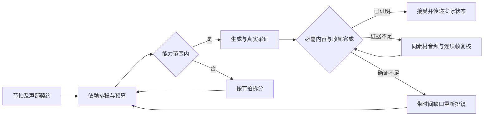

# 分镜时长与结尾完成度优化方案

状态：原诊断与设计稿已获批准；2026-09-08 已实施，实际交付及验收边界见 [实施记录](duration-v2-implementation-2026-09-08.md)。日期：2026-09-08。对象：`wf-sanguo-history-drama`，三国原著史料短剧生产工作流。决策人为项目使用者，实施负责人尚未指定。

建议将“按统一语速计算唯一最短秒数”改成“按表演类型和动作依赖预算，生成后确认实际收束”。最新片段的 6 秒来自程序强制缩时；统一增加固定秒数只能缓解部分样本，不能解决漏算反应、提示词冲突和结束证据不完整。

## 问题与实际证据

核对的是最新记录 `record-4kibh7`，取证快照标题为“单步调试 · 2026/9/8 19:12:14”，交付前复核标题更新为“单步调试 · 2026/9/8 19:18:32”。该记录目前只有第一轮“甘陵街巷歌谣传唱”生成了视频，其他轮尚未生成；下述实片结论限于这一段，算法问题可能影响同类镜头。

| 环节 | 实际证据 | 含义 |
| --- | --- | --- |
| 大纲与首版分镜 | 原定 8 秒；首版模型响应也是 8 秒 | 原本留有比最终请求更多的时间，但首版仍有对白绑定等问题，并非已合格版本 |
| 自动修复 | 校验明确报“本镜应为 6 秒，实际声明 8 秒”；三次生成候选依次为 8、6、6 秒 | 较长预算被确定性校验拒绝 |
| 歌谣预算 | 14 字、一个逗号：`14 / 4.5 + 0.15 = 3.2611` 秒 | 对白的统一语速被用于有节奏的歌谣 |
| 最终排程 | 开场 0–1；主唱 1–4.3；群众反应 4.3–5；5–6 为站立、保持姿态 | 倾听、点头、跟唱三个义务合计仅分到 0.7 秒 |
| 时长计算 | 活动最晚结束于 5 秒，`ceil(5 + 0.3) = 6` | 只验证声明窗口的算术，没有核实其内容容量 |
| 请求与素材 | 请求 6 秒；供应商返回 6.041 秒；本地解码 6.04 秒、24 fps，末帧 PTS 6.000 | 文件基本达到请求时长；没有证据表明本段被合成环节裁短 |
| 已匹配对白 | ASR 对齐跨度 0.37–4.99，共 4.62 秒，覆盖率 13/14 | 比规划的 3.26 秒多约 1.36 秒，即约 42%；这还是不完整词对齐 |
| 原始 ASR | 歌谣候选两段覆盖 0.37–5.53；末尾另识别“好”至 5.83 | 尾词及多出的人声须听音复核，不能把识别文本直接视为发音事实 |
| 语速检查 | 容许 `14 / 3.3 + 0.15 + 0.25 = 4.6424` 秒，4.62 因此通过 | 规划仅给 3.26，验收却容许约 4.64；下游反应空间未随之扩展 |
| 尾部检查 | `6.04 - 5.83 = 0.21` 秒；下界为 `0.3 - 0.25 = 0.05` 秒，仍在允许区间 | 这是声音结束余量，不是群众反应完成证明 |

已抽取本地视频 4.000–6.000 秒的 49 张原生帧，并检查间隔拼图及最后 16 张连续帧。可见主角走近人群，临近片尾部分群众手部和上身姿态仍在变化。静帧不能证明完整跟唱、完整点头或全部回应已经收束；自然微动本身也不能作为“未完成”的充分证据。用户描述与时间预算风险一致，不能据此宣称每个末动作都已被逐一证实缺失。

取证时执行只完成到 `sanguo-media-metrics`，独立观察及后续审核均为 `idle`。交付前只读复核发现应用继续推进，独立观察变为 `failed`，原要求审核、综合审核、成片验收仍未执行。分镜、视频请求、视频采证和指标四份输出的哈希比对均未改变，本文诊断仍对应同一素材。已有 `speechValidation.passed=true` 不代表成片已通过验收；并发状态变化记录于 [交付复核](../logs/duration-design-2026-09-08/read-only-proof.json)。

证据入口：

- [诊断摘要与离线复算](../logs/duration-design-2026-09-08/diagnostic-summary.json)：含候选顺序、失败反馈、请求时长、ASR、当前门禁状态和视频 SHA-256。
- [原视频](../public/generated/verified-fc10cecc53894924b913.mp4)。
- [原生尾部帧序列](../logs/duration-design-2026-09-08/native-tail-sequence.png)及[最后 16 帧](../logs/duration-design-2026-09-08/native-last-16.png)。这些图片使用解码 PTS，不把工作流的采样请求标签当实际帧时间。

## 用户场景、目标与非目标

用户需要看到一段完整动作和回应，再自然切到下一镜；适用于歌谣、对话、转身离开、递接物、多人反应等镜头。自然呼吸、走动延续等背景动作可以继续，承诺在本镜完成的剧情动作必须有可辨认的结果。

目标是减少因时长不足产生的重拍和突兀结束，同时保留自然语速、合理表演和原剧情覆盖。下一镜必须基于实际已完成状态继续。

原设计阶段只做诊断和方案；用户随后批准实施。持续不采用的方案：不统一固定为 9 秒或 15 秒，不删除原台词和必要节拍来迎合预算，不用慢放、补静帧、定格画面伪造动作完成，不声称已验证逐音素口型同步。

## 根因与方案选择

当前代码证据集中在 [history-pacing.ts](../src/history-pacing.ts) 的 `speechBudgetSeconds`、`performanceStoryboardTiming`、`dynamicStoryboardTiming`，以及 [workflow-core.ts](../src/workflow-core.ts) 的 `duration !== timingEstimate.requiredDuration` 校验（当前第 1788 行）。

除上述算术问题，还存在两项会让“单纯延长”失效的冲突：

1. 时间轴要求群众“跟着哼唱”，但音轨只列主唱，追加口型规则要求“仅主唱发声、其他人倾听”。角色集合也只声明主唱。需要明确群众作为场内群演及可发声参与者，避免和禁止未声明人物的规则冲突。
2. 提示词要求 5–6 秒保持姿态，同时又要求回应完成后仅留 0.3 秒。结构化活动只排到 5 秒，文本另写到 6 秒，反映时间数据与导演文本存在多个来源。

| 选项 | 预期效果 | 选择 |
| --- | --- | --- |
| 全部固定增加 2–3 秒 | 可给部分片段留余量，但长对白仍可能不足、简单镜头会空等 | 不作为全局策略 |
| 再让模型自由预估一个秒数 | 能考虑部分语义，但无法约束遗漏、冲突和虚假并行 | 只让模型拆解节拍和表演意图 |
| 共享预算策略＋依赖排程＋实际完成门禁 | 有解释、可复算，能处理长短镜头及失败分支 | 推荐，分阶段实施 |

## 需求与行为契约

- FR-001 — 每次规划必须输出并保存同一版本的 `TimingPolicy`，供分镜生成、确定性校验、视频提示词和成片指标共同引用。
- FR-002 — 出现主唱、吟诵、歌谣或群体回应时，规划器必须记录各声部的表演类型、内容、参与者、串并行关系和预算来源；发现“要求发声”与“禁止该角色发声”的冲突必须在视频请求前拦截。
- FR-003 — 每个本镜必须完成的节拍必须绑定动作主体、前置条件、估计区间、完成态和证据通道；程序必须按这些约束排程，不得凭模型写出的秒数认定动作足够。
- FR-004 — 时长校验必须接受有预算依据的保守时长，并拒绝低于内容排程与收尾余量的请求；不得继续要求时长精确等于唯一最小整数。
- FR-005 — 超过当前适配器能力上限时，系统必须沿完整节拍边界拆分，保持原剧情、台词和完成条件的可追溯覆盖；找不到可执行切点时返回重新排镜，不能直接钳到上限。
- FR-006 — 视频请求必须由一个结构化排程生成时长、台词窗口、提示词与采样锚点，并保存排程哈希；任一依赖字段变化后必须使下游旧结果失效。
- FR-007 — 关键句尾没有可靠词对齐时，采证必须保留末尾原始人声候选区间和不确定状态，不得用较早的“最后匹配字”证明整句已结束。
- FR-008 — 成片必须按节拍报告 `complete / incomplete / uncertain` 及原生时间证据；只有本镜必须完成的动作、回应和人声完成且具有可读收尾，才可结束本镜或换场。
- FR-009 — 完成证据不足时必须优先复核同一素材；确证时长不足时必须重新预算并返回分镜修复，不得原样重试同一个 6 秒请求。
- FR-010 — 若较长素材已完成全部义务且末尾确为空等，系统才可提出剪点；剪辑必须产生新素材并重新采证，无法凭延长静帧补齐缺失动作。
- FR-011 — 执行详情必须展示内容预算、最终请求、实际声画完成时间及差值，并区分“已生成、待审核、已接受、需修复”，防止将节点成功误读为视频合格。
- FR-012 — 校准数据必须按生成模型及版本、声音/表演类型、单人或群体分组，标记完整度和证据可信度；未完成及尾部截断样本必须作为低估风险记录，不能当作成功用时训练。
- FR-013 — 新排程必须事先区分导演参考时间窗与强制先后/截止条件；对参考窗外的实际事件，必须保留原节拍绑定并在同素材内查找、采证，不得因漏采直接判断缺失，也不得放宽强制条件制造通过。
- FR-014 — 对无词哼唱等非词汇声部，采证必须核验可听发声、声部及先后关系；曲调一致性属于明确要求时也必须核验，不能因文本为空而跳过该义务，不能用姿态代替声音证据。

### 统一时间模型

建议版本名为 `duration-v2`，保留旧字段只用于历史兼容。`audioType` 仍描述对白/旁白/环境声，新增 `deliveryStyle` 表示对话、旁白朗读、吟诵/歌谣、歌唱；不要用音轨类型替代表演节奏。

一个声部或动作节拍至少包含：

```text
id、sourceBeatId、actorIds、kind、deliveryStyle
textOrVocalization、dependsOn、overlapAllowedWith
durationEstimate { lower, expected, upper, source, confidence }
completion { requiredThisClip, finalState, modality, evidenceAnchor }
```

“边走边说”可并行；“说完后收手、对方接住后点头”必须保留依赖；同一人物不能同时完成不相容动作。依赖必须来自原剧情的先后关系，并经结构与内容审核，不能由模型删除依赖来缩短片长。群演倾听可以与主唱并行，群体回应必须明确何时开始、回应什么、何时算完成。

程序按依赖图与主体资源约束生成排程。冷启动用可解释的估计上界，积累可靠样本后再计算整条路径的分布；各节拍 P90 直接相加不能声称是整镜 P90。

```text
contentEndBudget = constrainedScheduleEnd(beatDurationBudgets)
safeEndBudget = contentEndBudget + endingReadabilityReserve
providerDuration = smallestSupportedDurationAtLeast(safeEndBudget)
```

`endingReadabilityReserve` 用于观众看清必需动作的结果，允许自然微动；它不等同于反应动作时长。开场建立、发声启动延迟、尾部字音、动作结果都按实际语义计时。测量误差单独存储为时间区间，不能从收尾空间扣除 0.25 秒来给排程“借时间”。

冷启动不直接把所有对白改为某个更慢的全局语速。先利用现有验收策略提供一致的保守基线，再按表演类型设置待校准预算；未知类型输出低置信度而非伪精确小数。过长的生成余量必须有来源和上限，超出配置范围时先重新规划，不能制造没有内容的等待。

### 对本次片段的候选重排

这一镜已有的 6 秒应退出可批准候选。仅用现有验收容许的 4.6424 秒主唱跨度，保留原来的开场 1、回应 0.7、尾部 0.3，也要 `ceil(1 + 4.6424 + 0.7 + 0.3) = 7` 秒；这个 7 秒仍没有解决多人反应不足。

建议先把本段定义为“主唱传唱原文，群众作短促无词同曲调回应”，明确群体声部，原有歌谣原文保持不变。此定义是本方案的导演假设，需要内容审核确认“多人知晓”与原始跟唱要求都得到覆盖；若要求群众完整再唱一遍，应增加整个声部预算，不能藏入 1.5 秒。

| 内容 | 建议初始预算 | 来源及限制 |
| --- | --- | --- |
| 开场建立、进入有效表演位置 | 0.8–1.0 秒 | 导演假设；走动可在主唱期间延续 |
| 主唱完整歌谣 | 5.2–5.5 秒 | 本次原始 ASR 候选跨度约 5.16 秒，待听音核验；并非统计分位数 |
| 群众可辨认回应及结束态 | 1.5–1.8 秒 | 包含点头过程和短促哼唱的初始假设，须实际声画验证 |
| 完成后的可读余量 | 0.3–0.5 秒 | 允许呼吸微动，不要求静止 |

以上保守串行预算为 7.8–8.8 秒，对应 8–9 秒候选；建议以 **9 秒作为这一镜的首次验证候选**。这是待验证方案，不是已经证明 9 秒必然足够。能确认合理并行时可缩短；完整群体复唱或更复杂反应则应加时或拆段。

9 秒候选可先排为：0–0.8 建立，0.8–6.3 主唱，6.3–8.1 群体短回应，8.1–8.6 完成态可读，剩余为供应商整数时长余量。最后一段不得引入新的剧情动作；只有实片证实空等时才考虑裁尾。供应商未按预期窗口执行时，以实际完成证据决定接受或修复。

### 生成后完成门禁与恢复

复用现有 `completionCriteria`、逐项要求审核、原生帧序列、补采和叙事换场门禁，补上每个必需节拍的实际结束区间。现有链路已经会阻止缺少完成证据的换场，问题不是“完全没有审核”，而是前置预算不足、局部指标口径不同，以及状态/动作证据还不够精确。



对动作过程应提供起始、发生过程、结束态的连续证据，不能用单张静尾帧证明点头或跟唱。末尾音频需要核对关键字、可能的未匹配音节及是否存在未声明声部。本样本的“进/静”只说明 ASR 匹配不确定，不能直接判台词错，也不能把实际句尾缩到 4.99 秒。

现有逐项审核和补采约束在原计划时间窗内，不能直接拿它们证明“原窗之后才完成”的事件。v2 必须在生成前明确 `timingConstraint`：模型编排的导演参考窗用于找事件，用户明确的精确时间、剧情前置关系及强制剪点属于硬约束。事件先在参考窗附近查找，必要时扩展到同一片段，在 `sourceBeatId` 下保存实际发生区间和额外证据；再独立检查硬约束及实际完成。不得修改原要求引用、偷偷扩大硬窗口或事后把硬条件降级；历史未分类时间窗保留原解释，新策略需要显式重规划。

无词群体声部另存 `vocalizationType / actorGroup / expectedAudibility / melodyRelation / completionCue`。应提供实际音频片段，核对可听的哼唱过程、与主唱的次序/重叠，以及必要的同曲调关系；不套用“汉字数为零所以耗时为零”的 ASR 公式。画面只能辅助归属声部，不能单独证明群体发声或旋律一致。当前自动能力无法核实的条件保持音频 `uncertain`，回到同素材听音复核。

剪点以全部本镜必需事件完成时间上界为基础，再加可读余量；不是“最后一个声音时间”，也不是必须等背景所有人停止运动。若可用片长落在完成时间的不确定区间内，返回 `uncertain`。补证次数耗尽仍不清楚，则保持未验收并呈现具体缺口。

确定性的预算不足或错误排程返回分镜修复；不可观察返回同素材补证；已有足够时长但供应商遗漏动作，先修正冲突或复杂度再有界重拍。续拍只在原剧允许、实际尾态可靠且能保护声画连续性时作为选项，不能用下一镜掩盖上一镜未完成的收束。

付费动作沿用项目现有用户授权和预算规则。本次设计不触发调用；未来恢复必须携带新排程哈希及具体修复原因，同一失败请求不得无差别循环购买。

## 验收标准与需求追溯

- AC-001 — 给定本次完整快照，验证旧算法离线复算为 6 秒，旧候选顺序为 8→6→6；新策略中仅因比最短值长不得拒绝 8 或 9 秒，存在内容下界冲突则必须指出具体节拍。覆盖 FR-001、FR-004。
- AC-002 — 给定“群众跟唱”与“仅主唱可发声”的原请求，验证生成前必须报声部冲突；补齐群体角色、发声与并行契约后才可进入排程。覆盖 FR-002。
- AC-003 — 给定“说完→递出→接住→点头”和“边走边说”两个样例，验证前者保留依赖，后者只扣除合法并行时间；禁止把四个前者动作塞到统一 0.7 秒反应窗口。覆盖 FR-003。
- AC-004 — 给定新预算超过当前适配器 15 秒上限的样例，验证拆分后原台词及每个 requiredBeat 保持可追溯、顺序正确、同场状态衔接；不得把时长钳到 15。覆盖 FR-005。
- AC-005 — 给定已生成的排程，修改一个句尾或动作依赖，验证请求时长、提示词、采样时间共同更新且哈希变化，旧视频及审核不能挂到新排程。覆盖 FR-006。
- AC-006 — 给定本次 ASR 13/14 对齐、原始尾字至 5.53 的证据，验证不会仅用 4.99 证明句子完成；尾字不明返回补证且保留原始识别，不自动改字制造通过。覆盖 FR-007。
- AC-007 — 给定“声音结束但人物刚抬手”“完整点头后自然呼吸”“末帧看不清动作”三种真实素材，验证依次需要动作复核、可基于完成态通过、保持 uncertain；不得仅凭微动拒绝或仅凭静态姿势放行。覆盖 FR-008。
- AC-008 — 给定确证结束前动作未完成的视频，验证反馈包含未完成节拍、实际区间、所需新增预算，返回重新排镜；给定证据不足的视频，验证只走同素材补证，达到次数上限停止自动循环。覆盖 FR-009。
- AC-009 — 给定完整内容后冗长空等的素材，验证只提出保留全部必需事件和余量的剪点；实施裁剪后必须对新素材重新采证。给定缺动作的素材，不得输出补静帧修复。覆盖 FR-010。
- AC-010 — 给定本次取证时只完成至指标节点的执行，验证详情必须显示“已生成、待审核”，同时展示 8 秒大纲、6 秒请求、6.04 秒实长和声画结束不确定性；给定交付时独立观察失败的状态，必须显示审核失败及待恢复步骤，均不得显示成片合格。覆盖 FR-011。
- AC-011 — 给定重复素材、截断素材、低覆盖 ASR 和不同模型版本的样本，验证前者按媒体哈希去重、截断单独记风险、低可信样本不用于成功用时分布、模型版本分组；样本量不足不得展示可靠 P90/P95。覆盖 FR-012。
- AC-012 — 在实施并获得实际生成授权后，用相同原文及节拍验证本段 9 秒候选：必须检查主唱末句、群众回应过程及自然剪点；同时复核简单短镜头、长对话和跨镜动作。报告必须分开代码回放、单段实片和整集观看结论，不以一次生成成功代替质量验收。覆盖 FR-003、FR-004、FR-008。
- AC-013 — 给定回应晚于导演参考窗、但先后关系正确且强制截止前已完成的素材，验证系统能绑定原节拍查找实际完成证据；给定违反用户明确硬截止的同类素材，仍必须报告违反时序。补采不得改写原要求。覆盖 FR-013。
- AC-014 — 给定无词群众声部，验证空文本仍产生非零预算和独立声音验收项；只有抬手画面而没有可靠哼唱证据时不得通过，同曲调无法确认时必须保留 uncertain 并提供待听音区间。覆盖 FR-014。

## 观测、质量要求与校准

- OBS-001 — 每个尝试记录 `policyVersion / scheduleHash / modelVersion / deliveryStyle / estimateSource / estimatedInterval / requestedDuration / decodedDuration / actualCompletionInterval / remainingMandatoryBeats / decision / repairReason`，关联原始要求和素材哈希。
- OBS-002 — 分组展示首轮完整率、确证截断率、证据不足率、已证实空等时长、付费生成秒数/最终接受秒数、重拍次数；给出分母和样本量，不能靠增加 uncertain 美化截断率。
- NFR-001 — 新确定性排程不能增加视频生成调用；采证优先复用同素材及现有审核链，补采和修复均有配置上限。
- NFR-002 — 阶段一回归集中，所有确证截断必须阻止换场，所有关键完成证据不足必须保持 uncertain；实片质量提升在新增实片验证后才报告。

初始验收采用上面的有标签回归集，不虚构当前缺陷率。建议每个主要“模型版本×表演类型”积累至少 30 个独立、完整且证据可靠的片段后再试验经验分位数；这个样本门槛是初始工程参数，不能据 30 个样本声称尾部分位数稳定。更细分组不足时回退到保守父组，并公开置信度。

截断记录是“所需时间大于当前已观测范围”的下界样本，不可将实际 6 秒写成成功完成用时。校准要保留失败分母，避免仅用通过样本低估复杂镜头的耗时。

## 实施顺序、迁移与回滚

1. 第一阶段：去掉精确最短时长强制；统一规划和验收策略；解决本段主唱/群体声部冲突；补关键句尾不确定性与完成态门禁。用本次真实输入离线回放，不买新视频。
2. 第二阶段：将必需节拍和串并行依赖纳入排程，统一产生提示词/时长/采样契约；按完整节拍拆段，并接入已有失效、重试和连续性机制。
3. 第三阶段：实施后的实际授权范围内验证本段及不同类型样本，建立分组校准；确认单段后再验收整集的剪接和叙事连续性。

建议改动落点：`history-pacing.ts`、`storyboard-prompt.ts`、`storyboard-pacing-repair.ts`、`workflow-core.ts`、`video-prompt-input.ts` 负责预算与单一排程；`model-adapters.ts` 负责一致的发声约束；`transcribe-quality.py`、`speech-metrics.ts`、`speech-quality.ts` 负责不确定音频区间；`quality-node-presets.ts`、`media-requirement-coverage.ts`、`media-adaptive-sampling.ts` 及 `history-pacing.ts` 的换场检查负责实际完成证据。优先扩展现有链路。

- ROLL-001 — 以 `duration-v2` 配置开关上线，只影响新执行或明确从规划节点分叉的执行；历史记录保留原策略、参数和素材，不追溯改写“已生成 6 秒”。
- ROLL-002 — 迁移前保存工作流、节点内嵌代码和模型选择；验证持久化配置、实际请求与执行快照的一致性及重复迁移幂等性。
- ROLL-003 — 回滚恢复原策略入口和配置，不覆盖已生成素材或其他在途编辑；v2 执行冻结其策略版本，继续原版本或显式分叉，禁止半途混用 v1/v2。回滚不能把已标记不完整的视频自动放行。

## 风险与待决策事项

主要风险是保守预算增加成本或空等、复杂群体声部继续被忽略、ASR 对专名/歌谣误识别，以及静帧无法证明动作过程。分别通过有依据的预算范围、声部一致性门禁、保留时间不确定区间与同素材听音、原生连续证据和实际观看应对。

建议采用本段 9 秒候选及短促群体无词回应作为首个验证方向；是否要求完整群体复唱会明显改变预算，实施时必须按原剧情解释明确记录。新策略的补采/重拍预算、首批实片样本规模和校准分位数目标由项目使用者结合成本选择；本稿不宣称这些参数已获批准或完成实测。

变更记录：2026-09-08，基于最新真实执行、模型候选流水、离线算法复算和本地原生尾帧完成初稿。仅新增方案和诊断证据。
